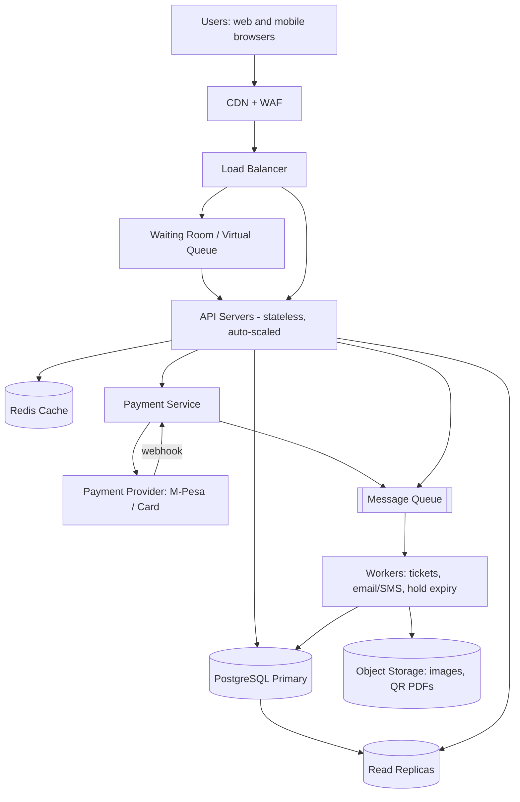

# TicketHub: Event Ticketing System Design

**Course:** Web Foundations, Day 8 final assignment
**Problem:** A website that sells tickets for concerts and events, and must survive the moment a very popular concert goes on sale.

**Given facts**

| Fact | Value |
|---|---|
| Registered users | 2,000,000 |
| Visitors on a normal day | 50,000, each viewing 10 pages |
| Tickets sold on a normal day | 5,000 |
| Big sale | 200,000 people try to buy 20,000 seats within the first 10 minutes |

---

## 1. Requirements

### 1.1 Functional requirements

1. A user can register, log in and log out.
2. A user can browse and search events by name, artist, city and date.
3. A user can view one event's details and its seat map (available / held / sold).
4. A user can **hold** one or more seats for a limited time (10 minutes) while they pay.
5. A user can pay for the held seats (card or M-Pesa) and receive confirmation.
6. A user can view their tickets (with a QR code) and past orders.
7. Held seats that are not paid for are released automatically when the hold expires.
8. An organiser/admin can create events and set seat prices.

### 1.2 Non-functional requirements

| Quality | Requirement | Why it matters |
|---|---|---|
| **Speed** | Browsing pages load in under 300 ms (95th percentile). Holding a seat responds in under 500 ms. | Users abandon slow sites, and during a sale every second of delay means more retries and more load. |
| **Correctness** | A seat is **never sold to two people**. A user is never charged without getting a ticket, and never gets a ticket without paying. Retrying a request never causes a double charge. | Selling the same seat twice means angry customers, refunds and lost trust. Correctness beats speed whenever the two conflict. |
| **Fairness** | People who arrive first get served first (first-come, first-served queue). A limit of 4 tickets per user per event. Bots and scalpers are throttled. | With 200,000 people chasing 20,000 seats, 90% will be disappointed. They must at least feel the process was fair. |
| **Availability** | 99.9% uptime overall; the browsing side stays up even if payments are slow. | Downtime during a sale is the worst possible moment to fail. |
| **Scalability** | Handle roughly 500x the normal load for short bursts without redesign. | Sales are rare but huge. |
| **Durability** | Paid orders are never lost (database replication and backups). | Money is involved. |
| **Security** | HTTPS everywhere, hashed passwords, card data handled only by the payment provider. | Protect users' money and identity. |

**Key design principle:** *Reads can be approximate and cached; writes that touch seats and money must be exact.*

---

## 2. Estimates

### 2.1 Normal day

| Quantity | Calculation | Result |
|---|---|---|
| Page views per day | 50,000 visitors x 10 pages | **500,000 views/day** |
| Average page views per second | 500,000 / 86,400 s | **about 6 per second** |
| Realistic busy-hour peak (most traffic falls in about 8 waking hours, plus evening spikes, so assume 10x the average) | 6 x 10 | **about 60 per second** |
| Ticket purchases per day | given | **5,000/day** |
| Purchases per second (average) | 5,000 / 86,400 | **about 0.06 per second** (one purchase every 17 seconds) |
| Busy-hour purchases | assume 10x | **under 1 per second** |
| Orders stored per year | 5,000 x 365 | **about 1.8 million rows/year**, which is small for any database |

**Conclusion for normal traffic:** this is a *read-heavy* system (500,000 views vs 5,000 purchases, a ratio of 100 to 1), and one modest server plus one database handles it comfortably.

### 2.2 The big sale (peak)

Assumptions: the 200,000 buyers arrive in the first 10 minutes (600 seconds). While waiting they refresh the seat map and try several seats before succeeding or giving up.

| Quantity | Calculation | Result |
|---|---|---|
| Users arriving per second | 200,000 / 600 | **about 333 new users/second** |
| Requests per user (event page, seat map refreshes, hold attempts, payment) | assume about 10 | 2,000,000 requests in 10 minutes |
| Request rate | 2,000,000 / 600 | **about 3,300 requests/second** |
| Seat-hold attempts | 200,000 users x about 3 tries / 600 s | **about 1,000 hold attempts/second** |
| Successful holds (maximum possible) | 20,000 seats / 600 s | **about 33 per second** |
| Payments | at most 20,000 / 600 s | **about 33 per second** |
| Competition | 200,000 buyers / 20,000 seats | **10 people for every seat**, so 90% will fail |

### 2.3 Comparison

| Measure | Normal day | Big sale | Increase |
|---|---|---|---|
| Page/API requests per second | about 6 (peak about 60) | about 3,300 | **about 550x average, 55x the normal busy hour** |
| Purchases per second | about 0.06 | about 33 | **about 550x** |
| Seat-hold attempts per second | negligible | about 1,000 | contention on a few thousand rows |
| Duration | all day | 10 minutes | very short, very sharp spike |

**What the comparison tells us**

1. The spike is roughly **500x** the average load, but it lasts only minutes. Paying for servers sized for the peak all year is wasteful, so we **scale out temporarily** and **use a queue to flatten the spike**.
2. The danger is not total volume (3,300 requests/second is modest). It is **contention**: about 1,000 attempts per second fighting over the *same* 20,000 rows. That is why correct locking matters more than raw speed.
3. 90% of attempts must fail quickly and politely ("sold out"), so failure paths must be cheap.

---

## 3. API Design

REST over HTTPS, JSON bodies, authentication with a bearer token (`Authorization: Bearer <token>`).

| # | Purpose | Method and path | Request | Success response | Errors |
|---|---|---|---|---|---|
| 1 | Log in | `POST /auth/login` | `{"email","password"}` | `200` `{"token"}` | `401` wrong credentials |
| 2 | Browse/search events | `GET /events?q=&city=&date=&page=1` | none | `200` list of events (id, name, date, venue, price from) | `400` bad filter |
| 3 | View one event | `GET /events/{event_id}` | none | `200` event details | `404` no such event |
| 4 | View seats | `GET /events/{event_id}/seats?section=A` | none | `200` `[{"seat_id","row","number","price","status"}]` | `404` |
| 5 | **Hold seats** | `POST /events/{event_id}/holds` | `{"seat_ids":[101,102]}` | `201` `{"hold_id","expires_at"}` | `409` a seat was taken, `429` too many requests, `422` more than 4 seats |
| 6 | Release a hold | `DELETE /holds/{hold_id}` | none | `204` | `404`, `403` not your hold |
| 7 | **Pay (create order)** | `POST /orders` with header `Idempotency-Key: <uuid>` | `{"hold_id","payment_method":"mpesa","phone":"2547..."}` | `202` `{"order_id","status":"PENDING_PAYMENT"}` | `410` hold expired, `409` hold not yours |
| 8 | Payment confirmation callback | `POST /payments/webhook` (called by the payment provider, signature verified) | provider payload | `200` | `400` bad signature |
| 9 | View my order status | `GET /orders/{order_id}` | none | `200` `{"status":"PAID"}` | `404` |
| 10 | **View my tickets** | `GET /me/tickets` | none | `200` `[{"ticket_id","event","seat","qr_code"}]` | `401` |

**Example: holding seats**

```
POST /events/42/holds
Authorization: Bearer abc123
{"seat_ids": [101, 102]}

201 Created
{"hold_id": "h_7f3a", "seats": [101, 102], "expires_at": "2026-10-23T18:10:00Z"}
```

**Example: conflict (someone else got seat 102 first)**

```
409 Conflict
{"error": "SEAT_UNAVAILABLE", "unavailable_seat_ids": [102]}
```

**Design notes**

* Holding and paying are **separate steps**. A hold gives the user time to pay without locking the database for minutes.
* The `Idempotency-Key` header means a retried payment request (for example after a network drop) returns the same order instead of charging twice.
* Payment is **asynchronous** (`202`): the provider calls our webhook when money actually arrives, and only then do seats become SOLD.

---

## 4. Data Model

### 4.1 Tables

**users**

| Column | Type | Notes |
|---|---|---|
| user_id | BIGINT | **PK** |
| email | VARCHAR | **UNIQUE**, NOT NULL |
| password_hash | VARCHAR | NOT NULL (never store plain passwords) |
| name, phone | VARCHAR | |
| created_at | TIMESTAMP | |

**events**

| Column | Type | Notes |
|---|---|---|
| event_id | BIGINT | **PK** |
| name | VARCHAR | NOT NULL |
| venue | VARCHAR | |
| city | VARCHAR | indexed for search |
| starts_at | TIMESTAMP | indexed for date search |
| sale_opens_at | TIMESTAMP | when tickets go on sale |
| max_tickets_per_user | INT | default 4 |

**event_seats** (one row per physical seat *for each event*)

| Column | Type | Notes |
|---|---|---|
| seat_id | BIGINT | **PK** |
| event_id | BIGINT | **FK** to events |
| section, row_label, seat_number | VARCHAR/INT | |
| price | DECIMAL | |
| status | VARCHAR | `AVAILABLE`, `HELD`, `SOLD`; **CHECK** status IN (...) |
| hold_id | VARCHAR | NULL unless held |
| held_by_user_id | BIGINT | **FK** to users, NULL unless held |
| hold_expires_at | TIMESTAMP | NULL unless held |
| | | **UNIQUE (event_id, section, row_label, seat_number)** so a seat cannot be created twice |
| | | **INDEX (event_id, status)** for fast "which seats are free" queries |

**orders**

| Column | Type | Notes |
|---|---|---|
| order_id | BIGINT | **PK** |
| user_id | BIGINT | **FK** to users |
| event_id | BIGINT | **FK** to events |
| hold_id | VARCHAR | the hold being paid for |
| total_amount | DECIMAL | |
| status | VARCHAR | `PENDING_PAYMENT`, `PAID`, `FAILED`, `REFUNDED` |
| idempotency_key | VARCHAR | **UNIQUE** so retries cannot create duplicates |
| created_at | TIMESTAMP | |

**tickets** (created only after payment succeeds)

| Column | Type | Notes |
|---|---|---|
| ticket_id | BIGINT | **PK** |
| order_id | BIGINT | **FK** to orders |
| seat_id | BIGINT | **FK** to event_seats |
| event_id | BIGINT | **FK** to events |
| qr_code | VARCHAR | unique code scanned at the gate |
| | | **UNIQUE (event_id, seat_id)**: the last line of defence against double-selling |

**payments** (a fifth table, to keep money records separate)

| Column | Type | Notes |
|---|---|---|
| payment_id | BIGINT | **PK** |
| order_id | BIGINT | **FK** to orders |
| provider_ref | VARCHAR | **UNIQUE**, the provider's transaction id (stops a webhook from being applied twice) |
| amount, status | | |

### 4.2 Relationships

```
users 1 ----< orders        (one user places many orders)
events 1 ----< event_seats  (one event has many seats)
events 1 ----< orders       (one event has many orders)
orders 1 ----< tickets      (one order contains one or more tickets)
event_seats 1 ---- 0..1 tickets  (a seat becomes at most ONE ticket)
orders 1 ----< payments     (an order may have several payment attempts)
users 1 ----< event_seats   (a user may currently hold several seats)
```

---

## 5. How TicketHub Prevents Two People Buying the Same Seat

The rule: **the database, not the application, decides who wins.** Application code can be wrong or slow, and two servers can run at the same moment. The database can make the decision atomically. There are four layers of defence.

### Layer 1: An atomic conditional update inside a transaction (the hold)

The seat is claimed with a single `UPDATE` that only succeeds if the seat is still free:

```sql
BEGIN;

UPDATE event_seats
SET    status = 'HELD',
       hold_id = :hold_id,
       held_by_user_id = :user_id,
       hold_expires_at = NOW() + INTERVAL '10 minutes'
WHERE  event_id = :event_id
  AND  seat_id IN (101, 102)
  AND  ( status = 'AVAILABLE'
         OR (status = 'HELD' AND hold_expires_at < NOW()) );  -- expired holds are re-claimable

-- The application checks: rows updated == number of seats requested?
--   yes -> COMMIT   (user holds all seats)
--   no  -> ROLLBACK (someone else got at least one; return 409)
```

Why this is safe: the database **locks each matching row** while it updates it. If two users run this at the same instant for seat 101:

| Time | User A | User B |
|---|---|---|
| t1 | UPDATE seat 101 (condition true, row locked) | |
| t2 | | UPDATE seat 101 (**waits** for A's lock) |
| t3 | COMMIT (seat is now HELD by A) | |
| t4 | | Lock released; the condition is **re-checked**, status is now HELD and not expired, so the condition is false and **0 rows updated** |
| t5 | | Application sees 0 rows, ROLLBACK, returns **409** |

Exactly one of them wins, however many servers are running.

### Layer 2: All-or-nothing (the "A" in ACID)

If a user asks for 3 seats and only 2 are free, the transaction **rolls back**, so they never end up with a partial group. To avoid deadlocks (A holds seat 1 and wants 2 while B holds 2 and wants 1), every request locks seats in **sorted seat_id order**.

### Layer 3: Time-limited holds

A hold lasts 10 minutes. A background worker also resets expired holds to `AVAILABLE` every 30 seconds, and the `hold_expires_at < NOW()` condition above means an expired hold can be taken even before the worker runs. Abandoned carts therefore never lock seats forever.

### Layer 4: Constraints as the safety net

If a bug ever slips past the application logic, the database still refuses duplicates:

* `UNIQUE (event_id, seat_id)` on **tickets**: a second ticket for the same seat fails with a constraint error.
* `CHECK (status IN ('AVAILABLE','HELD','SOLD'))` stops invalid states.
* `UNIQUE (idempotency_key)` on **orders** and `UNIQUE (provider_ref)` on **payments**: a retried request or a repeated webhook cannot create a second order or apply the same payment twice.

### Confirming payment safely

When the payment provider's webhook arrives:

```sql
BEGIN;
UPDATE event_seats
SET    status = 'SOLD'
WHERE  hold_id = :hold_id AND status = 'HELD' AND hold_expires_at > NOW();
-- rows updated == seats in the order?  
--   yes -> INSERT tickets, UPDATE orders SET status='PAID', COMMIT
--   no  -> (hold expired and the seat was re-sold) ROLLBACK, mark order FAILED, REFUND the payment
COMMIT;
```

This covers the awkward case where a user pays at minute 11. The money is refunded rather than the seat being sold twice.

### Why not just check first and then update?

A "SELECT, then UPDATE" approach has a **race condition**: both users SELECT and see "available", both then UPDATE, and both believe they own the seat. The conditional `UPDATE ... WHERE status='AVAILABLE'` removes the gap between *checking* and *acting*, because both happen in one atomic step.

**Summary:** atomic conditional update + transaction + expiry + UNIQUE constraints = **at most one buyer per seat, guaranteed by the database**.

---

## 6. Architecture

### 6.1 Diagram



Plain-text version of the same picture:

```
Users
  |
CDN + WAF (static files, bot filtering, rate limits)
  |
Load Balancer
  |
Waiting Room (Redis queue) ----> admits users at a controlled rate
  |
API Servers (stateless, many copies)
  |-- Redis Cache          (event details, seat-map snapshots, queue state)
  |-- PostgreSQL Primary   (all writes: holds, orders, tickets)  --> Read Replicas (browse/search)
  |-- Payment Service ----> Payment Provider (M-Pesa/card) --webhook--> Payment Service
  |
Message Queue --> Workers (create tickets, send email/SMS, expire holds) --> DB / Object Storage
```

### 6.2 Components

| Component | What it does | Why it is needed |
|---|---|---|
| **CDN + WAF** | Serves images, CSS, JS and event pages from servers near the user; blocks bots and abusive IPs. | Removes most browse traffic before it reaches our servers and cuts scalper bots. |
| **Load balancer** | Spreads requests across API servers and drops unhealthy ones. | No single server is a bottleneck or a single point of failure. |
| **Waiting room (virtual queue)** | At sale time, users get a queue position and are admitted in batches (for example 1,000 at a time) based on how fast seats are being decided. | Turns a 3,300 requests/second spike into a steady stream the database can handle, and gives **fairness** (first come, first served). |
| **API servers (stateless)** | Run the business logic: validate input, call the cache and database, enforce limits (4 tickets per user). | Stateless means we can add dozens of copies during a sale and remove them afterwards. |
| **Redis cache** | Stores event details, a seat-availability snapshot (refreshed every 1 to 2 seconds), and the queue. | Seat-map views are the heaviest read load, so serving them from memory keeps the database free for real writes. |
| **PostgreSQL primary** | The single source of truth for seats, orders, tickets. All holds and payments are transactions here. | Provides ACID guarantees and constraints that prevent double-booking. |
| **Read replicas** | Copies of the database used for browse/search and "my tickets". | Offloads reads so the primary only handles writes. |
| **Payment service** | Creates payment requests and receives the provider's webhooks, verifying signatures. | Keeps card and M-Pesa logic isolated, so a slow provider cannot stall seat holding. |
| **Message queue** | Holds jobs such as "send ticket email" and "generate QR PDF". | Slow work happens after the user gets their answer, and jobs are not lost if a worker crashes. |
| **Workers** | Create tickets, send SMS/email, release expired holds every 30 seconds. | Keeps the request path fast and automates cleanup. |
| **Object storage** | Stores event images and ticket PDFs. | Cheap, durable storage for large files; keeps them out of the database. |

### 6.3 How the design survives the big sale

1. **Before the sale:** pre-scale API servers, pre-warm the cache with the event and seat data, and put the event page behind the CDN.
2. **Waiting room:** the 200,000 users are queued and admitted gradually. The database never sees more than a few hundred active buyers at once, instead of 200,000.
3. **Cheap reads:** the seat map comes from the Redis snapshot, so thousands of refreshes per second never touch PostgreSQL.
4. **Small, fast writes:** a hold is one short transaction on a few rows (about 1,000 attempts/second, well within what a single PostgreSQL primary can do). Rows are partitioned by event, so one hot event does not slow others.
5. **Cheap failure:** 180,000 people will lose. A failed hold is one quick `UPDATE` touching 0 rows and a `409`, with no expensive work.
6. **Payments off the critical path:** payment is asynchronous with webhooks, so slow M-Pesa or card responses do not hold database locks.
7. **Protection:** per-user and per-IP rate limits, one active hold per session, and a 4-ticket cap stop bots from grabbing hundreds of seats.
8. **Graceful degradation:** if load is still too high, the waiting room slows admission instead of letting the system crash.

---

## 7. Trade-offs

### Trade-off 1: Strong consistency (single database primary) vs. higher write scalability

* **Choice:** all seat writes go to one PostgreSQL primary with transactions and locking.
* **Gain:** guaranteed correctness (no double-booking), simple to reason about.
* **Cost:** the primary is a bottleneck. We cannot scale writes by adding servers.
* **Why acceptable:** peak writes are only about 1,000 attempts/second (about 33 successful) which one primary handles, and the waiting room protects it. A distributed or eventually consistent store (for example, a NoSQL database with eventual consistency) would scale writes but risks selling a seat twice, which is unacceptable for tickets.

### Trade-off 2: Waiting room (fairness and stability) vs. user convenience and complexity

* **Choice:** during a big sale, users wait in a queue before they may pick seats.
* **Gain:** the system stays up, access is fair and bots are limited.
* **Cost:** users wait (maybe minutes), some give up, and we must build and operate the queue.
* **Why acceptable:** a crashed site serves nobody, and a visible queue feels fairer than a free-for-all where the fastest connection or bot wins.

### Trade-off 3: Cached seat map (speed) vs. accuracy

* **Choice:** the seat map is a 1 to 2 second old snapshot from Redis.
* **Gain:** the database is protected and pages are fast.
* **Cost:** a user may click a seat that was just taken and receive a `409`.
* **Why acceptable:** the *hold* step always checks the database, so the stale view can never cause a wrong sale, only a polite retry.

### Trade-off 4: Hold duration (10 minutes) vs. seat utilisation

* **Choice:** a seat is reserved for 10 minutes while the user pays.
* **Gain:** users have enough time to pay with M-Pesa or a card.
* **Cost:** abandoned holds keep seats unavailable for up to 10 minutes, and real buyers see "sold out" while seats may later reappear.
* **Why acceptable:** a shorter hold (for example 3 minutes) would frustrate honest buyers on slow connections. Expiry is automatic, and the waiting room limits how many seats can be held at once.

---

## Key Points Summary

| Part | One-line summary |
|---|---|
| Requirements | Speed, **correctness (never double-sell)** and **fairness** matter most. |
| Estimates | Normal about 6 req/s; big sale about 3,300 req/s (about 550x), with 10 buyers per seat. |
| API | 10 endpoints; hold and pay are separate; idempotency key on payment. |
| Data model | users, events, event_seats, orders, tickets, payments, linked by foreign keys. |
| Double-booking | Atomic conditional UPDATE in a transaction + hold expiry + UNIQUE constraints. |
| Architecture | CDN, waiting room, stateless APIs, cache, one primary DB with replicas, queue and workers. |
| Trade-offs | Consistency over write scale; fairness over convenience; cache speed over accuracy; hold length. |